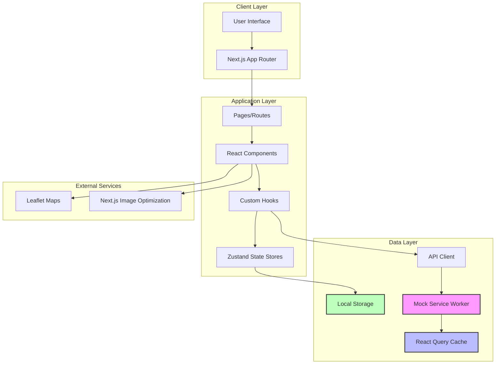

# Design Document: Website Properties Perumahan

## Overview

Website Properties Perumahan adalah platform frontend modern untuk menampilkan listing properti perumahan di Indonesia dengan fokus pada pengalaman pengguna yang intuitif, responsif, dan performa tinggi. Platform ini dibangun menggunakan pendekatan component-based architecture dengan React dan Next.js 14+ sebagai framework utama, didukung oleh teknologi modern untuk memastikan performa optimal dan aksesibilitas yang baik.

Platform ini adalah **frontend-only application** yang menggunakan Mock Service Worker (MSW) untuk simulasi API, memungkinkan pengembangan dan testing tanpa backend yang sebenarnya.

### Tujuan Utama

1. **User Experience Excellence**: Memberikan pengalaman browsing properti yang smooth dan menyenangkan dengan animasi entrance yang halus dan interaksi responsif
2. **Performance First**: Memastikan loading cepat (< 3 detik untuk konten utama) dan interaksi responsif dengan infinite scroll dan lazy loading
3. **Mobile-First Approach**: Mengutamakan pengalaman mobile tanpa mengorbankan desktop, dengan responsive layout yang menyesuaikan dari 1 kolom (mobile) hingga 4 kolom (desktop)
4. **Accessibility Compliance**: Memenuhi standar WCAG AA untuk inklusivitas dengan keyboard navigation, screen reader support, dan color contrast 4.5:1

### Teknologi Stack

**Frontend Framework:**
- **React 18+** dengan TypeScript untuk type safety dan developer experience
- **Next.js 14+** (App Router) untuk SSR/SSG, routing, dan optimisasi performa
- **TanStack Query (React Query)** untuk server state management, infinite pagination, dan caching dengan stale-while-revalidate strategy

**Styling:**
- **Tailwind CSS** untuk utility-first styling dan konsistensi design dengan mobile-first approach
- **Framer Motion** untuk animasi smooth dan transisi (entrance animations, hover effects, drawer/menu transitions)
- **Font**: sans-serif consistently across the entire UI via Tailwind's `font-sans`

**UI Components:**
- **Headless UI** atau **Radix UI** untuk accessible component primitives (modals, dropdowns)
- **React Hook Form** untuk form management dan submission
- **Zod** untuk schema validation pada form inputs

**Image Optimization:**
- **Next.js Image Component** untuk lazy loading, blur placeholder, dan optimisasi otomatis
- **Sharp** untuk image processing
- **WebP/AVIF** format support untuk ukuran file lebih kecil

**Maps Integration:**
- **React Leaflet** (wrapping Leaflet) untuk peta interaktif
- Dynamic import dengan `next/dynamic` untuk menghindari SSR issues

**State Management:**
- **Zustand** untuk global state (favorites, filters) dengan localStorage persistence
- **Local Storage API** untuk persistence favorites dan filter preferences

**API Mocking:**
- **MSW (Mock Service Worker)** untuk intercept API calls di browser dan test environments
- Browser worker: `src/mocks/browser.ts`
- Server handler: `src/mocks/server.ts`
- Handlers: `src/mocks/handlers.ts`
- Mock data: `src/mocks/data/properties.ts` (minimal 20 properti)

**Testing:**
- **Vitest** untuk unit testing dengan jsdom environment
- **React Testing Library** untuk component testing
- **Playwright** untuk E2E testing
- **jest-axe** atau **@axe-core/react** untuk automated accessibility testing
- **MSW** untuk API mocking dalam tests

**Build & Development:**
- **Next.js built-in** untuk bundling dan optimization
- **ESLint** + **Prettier** untuk code quality dan formatting
- **Husky** untuk pre-commit hooks

## Architecture

### High-Level Architecture



**Architecture Notes:**
- **MSW Layer**: Intercepts all API calls dan returns mock data, eliminating need untuk backend
- **React Query Cache**: Implements stale-while-revalidate strategy untuk optimal performance
- **Zustand Stores**: Manages client-side state (favorites, filters) dengan localStorage persistence
- **Next.js App Router**: Handles routing, SSR, dan code splitting automatically
- **Component Hierarchy**: Follows Atomic Design pattern (atoms → molecules → organisms)

### Folder Structure

```
src/
├── app/                          # Next.js App Router
│   ├── layout.tsx               # Root layout
│   ├── page.tsx                 # Home page
│   ├── properties/              # Properties routes
│   │   ├── page.tsx            # Property listing
│   │   └── [id]/               # Dynamic property detail
│   │       └── page.tsx
│   ├── favorites/               # Favorites page
│   │   └── page.tsx
│   └── contact/                 # Contact page
│       └── page.tsx
├── components/                   # React components
│   ├── ui/                      # Base UI components
│   │   ├── Button.tsx
│   │   ├── Input.tsx
│   │   ├── Modal.tsx
│   │   ├── Skeleton.tsx
│   │   └── ...
│   ├── layout/                  # Layout components
│   │   ├── Header.tsx
│   │   ├── Navigation.tsx
│   │   ├── Footer.tsx
│   │   ├── MobileMenu.tsx
│   │   └── SplashScreen.tsx
│   ├── property/                # Property-specific components
│   │   ├── PropertyCard.tsx
│   │   ├── PropertyGrid.tsx
│   │   ├── PropertyDetail.tsx
│   │   ├── ImageGallery.tsx
│   │   └── PropertyMap.tsx
│   ├── search/                  # Search components
│   │   ├── SearchBar.tsx
│   │   ├── FilterPanel.tsx
│   │   ├── SortDropdown.tsx
│   │   └── FilterDrawer.tsx
│   └── forms/                   # Form components
│       ├── ContactForm.tsx
│       └── FormField.tsx
├── hooks/                        # Custom React hooks
│   ├── useProperties.ts
│   ├── useSearch.ts
│   ├── useFilters.ts
│   ├── useFavorites.ts
│   ├── useInfiniteScroll.ts
│   ├── useMediaQuery.ts
│   └── useSplashScreen.ts
├── lib/                          # Utilities and helpers
│   ├── api/                     # API client
│   │   ├── client.ts
│   │   └── endpoints.ts
│   ├── utils/                   # Utility functions
│   │   ├── formatters.ts
│   │   ├── validators.ts
│   │   └── helpers.ts
│   └── constants/               # Constants
│       └── index.ts
├── store/                        # State management
│   ├── useFilterStore.ts
│   └── useFavoriteStore.ts
├── types/                        # TypeScript types
│   ├── property.ts
│   ├── filter.ts
│   └── api.ts
└── styles/                       # Global styles
    └── globals.css
```

### Component Architecture Pattern

Menggunakan **Atomic Design Pattern** dengan modifikasi:

1. **Atoms**: Base UI components (Button, Input, Icon)
2. **Molecules**: Kombinasi atoms (SearchBar, FilterItem, PropertyStat)
3. **Organisms**: Complex components (PropertyCard, FilterPanel, ImageGallery)
4. **Templates**: Page layouts
5. **Pages**: Next.js pages dengan data fetching

## Components and Interfaces

### Core Components

#### 1. PropertyCard Component

**Purpose**: Menampilkan ringkasan informasi properti dalam format card

**Props Interface:**
```typescript
interface PropertyCardProps {
  property: Property;
  onFavoriteToggle?: (id: string) => void;
  isFavorite?: boolean;
  priority?: boolean; // untuk image loading priority
}

interface Property {
  id: string;
  title: string;
  price: number;
  location: string;
  bedrooms: number;
  bathrooms: number;
  landArea: number;
  buildingArea: number;
  propertyType: 'Rumah' | 'Townhouse' | 'Villa';
  images: string[];
  isNew: boolean; // ditambahkan dalam 7 hari terakhir
  createdAt: string;
  features: string[];
  description: string;
  yearBuilt: number;
  floors: number;
  coordinates: {
    lat: number;
    lng: number;
  };
}
```

**Behavior:**
- Hover effect dengan scale transform dan shadow (Framer Motion)
- Lazy load images dengan blur placeholder menggunakan Next.js Image
- Badge "Baru" untuk properti yang ditambahkan dalam 7 hari terakhir (berdasarkan `createdAt`)
- Heart icon untuk favorite toggle dengan filled/outline state
- Click navigasi ke `/properties/[id]` detail page
- Entrance animation dengan smooth transition saat card pertama kali muncul
- Responsive: full width pada mobile, 2 kolom pada tablet, 3-4 kolom pada desktop

#### 2. SearchBar Component

**Purpose**: Input pencarian dengan debounce dan real-time results

**Props Interface:**
```typescript
interface SearchBarProps {
  onSearch: (query: string) => void;
  placeholder?: string;
  debounceMs?: number; // default 500ms
  initialValue?: string;
}
```

**Behavior:**
- Debounce input 500ms untuk mengurangi API calls (sesuai Requirement 2.2)
- Minimum 3 karakter untuk trigger search (sesuai Requirement 2.1)
- Clear button (X) saat ada input untuk reset pencarian
- Loading indicator saat searching untuk feedback visual
- Keyboard accessible dengan role="searchbox" dan ARIA attributes
- Search berdasarkan lokasi, nama perumahan, dan deskripsi properti (Requirement 2.3)

#### 3. FilterPanel Component

**Purpose**: Panel filter multi-kriteria untuk properti

**Props Interface:**
```typescript
interface FilterPanelProps {
  onFilterChange: (filters: PropertyFilters) => void;
  availableCounts?: FilterCounts; // jumlah properti per filter
  initialFilters?: PropertyFilters;
}

interface PropertyFilters {
  priceRange: {
    min?: number;
    max?: number;
  };
  bedrooms?: number[];
  bathrooms?: number[];
  landAreaRange: {
    min?: number;
    max?: number;
  };
  propertyTypes?: PropertyType[];
}

interface FilterCounts {
  bedrooms: Record<number, number>;
  bathrooms: Record<number, number>;
  propertyTypes: Record<PropertyType, number>;
}
```

**Behavior:**
- Real-time filter application dengan 300ms debounce (sesuai Requirement 3.6)
- Reset all filters button untuk menghapus semua filter aktif (Requirement 3.8)
- Show available counts per filter option (Requirement 3.7)
- Responsive: drawer on mobile (slide dari bawah/kiri), sidebar on desktop
- Persist filters in URL query params untuk shareable URLs
- Multiple filters dapat dikombinasikan secara bersamaan

#### 4. ImageGallery Component

**Purpose**: Galeri foto dengan lightbox dan navigasi

**Props Interface:**
```typescript
interface ImageGalleryProps {
  images: string[];
  alt: string;
  priority?: boolean;
}
```

**Behavior:**
- Main image dengan thumbnails di bawah
- Click thumbnail untuk ganti main image dengan 200ms transition (Framer Motion) - Requirement 5.3
- Click main image untuk buka lightbox fullscreen - Requirement 5.5
- Keyboard navigation: ArrowLeft/ArrowRight untuk navigasi, ESC untuk tutup - Requirement 5.6
- Touch swipe support untuk mobile (touch event handlers)
- Image counter "X / Y" di overlay main image - Requirement 5.7
- Lazy load thumbnails menggunakan Next.js Image dengan loading="lazy"
- Focus trap saat lightbox aktif untuk accessibility
- Previous/Next buttons untuk navigasi antar foto - Requirement 5.4

#### 5. ContactForm Component

**Purpose**: Formulir kontak dengan validasi

**Props Interface:**
```typescript
interface ContactFormProps {
  propertyId: string;
  propertyTitle: string;
  onSubmitSuccess?: () => void;
  onSubmitError?: (error: Error) => void;
}

interface ContactFormData {
  fullName: string;
  phone: string;
  email: string;
  message: string;
}
```

**Validation Rules:**
- fullName: required, min 3 characters (Requirement 6.1)
- phone: required, min 12 digits, format: +62xxx atau 08xxx (Requirement 6.3)
- email: required, valid email format (Requirement 6.2)
- message: required, min 10 characters (Requirement 6.1)

**Behavior:**
- Real-time validation on blur untuk immediate feedback (Requirement 6.4)
- Disable submit button saat validating/submitting atau ada validation errors (Requirement 6.5)
- Success toast: "Pesan Anda telah terkirim. Agen akan menghubungi Anda segera" (Requirement 6.6)
- Error toast: "Gagal mengirim pesan. Silakan coba lagi" (Requirement 6.7)
- Clear form setelah sukses submit
- Accessible error messages dengan ARIA attributes
- Label-input association dengan htmlFor/id untuk screen readers

#### 6. PropertyGrid Component

**Purpose**: Grid layout untuk menampilkan multiple PropertyCards

**Props Interface:**
```typescript
interface PropertyGridProps {
  properties: Property[];
  isLoading?: boolean;
  hasMore?: boolean;
  onLoadMore?: () => void;
  columns?: {
    mobile: number;
    tablet: number;
    desktop: number;
  };
}
```

**Behavior:**
- Responsive columns: 1 mobile (< 768px), 2 tablet (768px-1024px), 3-4 desktop (> 1024px) - Requirements 7.4, 7.5, 7.6
- Infinite scroll dengan intersection observer untuk auto-load saat scroll ke bawah - Requirement 1.3
- Skeleton loading untuk initial load dengan minimal 12 cards - Requirement 9.2
- Smooth entrance animations dengan stagger effect menggunakan Framer Motion - Requirement 1.1
- Empty state component saat `properties.length === 0` dengan pesan "Tidak ada properti yang sesuai" - Requirement 2.4
- Loading indicator saat fetching next page
- Smooth transition saat new cards muncul dari infinite scroll - Requirement 1.3

#### 7. Navigation Component

**Purpose**: Sticky navigation dengan responsive menu

**Props Interface:**
```typescript
interface NavigationProps {
  favoriteCount?: number;
}
```

**Behavior:**
- Sticky positioning saat scroll untuk akses mudah - Requirement 8.2
- Active link highlighting berdasarkan current pathname - Requirement 8.3
- Logo click → navigasi ke home page - Requirement 8.4
- Hamburger menu untuk mobile (< 768px) dengan smooth animation - Requirements 7.2, 8.5
- Favorite badge dengan count dari useFavoriteStore - Requirement 11.4
- Links: Home, Cari Properti, Tentang Kami, Kontak - Requirement 8.1
- Smooth open/close animations menggunakan Framer Motion

#### 8. PropertyMap Component

**Purpose**: Menampilkan lokasi properti di peta

**Props Interface:**
```typescript
interface PropertyMapProps {
  coordinates: {
    lat: number;
    lng: number;
  };
  title: string;
  zoom?: number;
  height?: string;
}
```

**Behavior:**
- Interactive map dengan marker di lokasi properti - Requirement 4.5
- Zoom controls untuk navigasi peta
- Lazy load map library menggunakan next/dynamic dengan ssr: false
- Fallback UI untuk error loading dengan pesan informatif
- Map height responsive: lebih pendek di mobile, lebih tinggi di desktop

#### 9. SplashScreen Component

**Purpose**: Menampilkan splash screen saat website pertama kali dimuat dengan animasi smooth dan tombol mulai

**Props Interface:**
```typescript
interface SplashScreenProps {
  onStart: () => void;
  isLoading?: boolean;
  autoHideDelay?: number; // default 5000ms
}
```

**Behavior:**
- Fullscreen overlay yang muncul saat website pertama kali dimuat - Requirement 12.1
- Menampilkan logo website, nama "Website Properties Perumahan", dan tagline menarik - Requirement 12.2
- Tombol "Mulai" yang prominent dan mudah diakses - Requirement 12.3
- Smooth fade-out animation (800ms max) saat tombol "Mulai" diklik - Requirement 12.4
- Loading indicator atau progress bar saat memuat konten utama - Requirement 12.5
- Background menarik (gradient atau gambar properti) - Requirement 12.6
- Memuat konten utama di background untuk mempercepat transisi - Requirement 12.7
- Auto-hide setelah 5 detik atau ESC key - Requirement 12.8
- Smooth entrance animations untuk semua elemen (logo, teks, tombol) - Requirement 12.9
- Fully responsive design untuk semua ukuran layar - Requirement 12.10
- Keyboard accessible dengan focus management
- Preload critical resources saat splash screen aktif
- Z-index tinggi untuk overlay di atas semua konten
- Prevent scroll saat splash screen aktif

**Animation Sequence:**
1. **Initial State**: Fullscreen dengan background gradient/image
2. **Logo Animation**: Fade in + scale dari 0.8 ke 1.0 (600ms)
3. **Text Animation**: Slide up + fade in dengan stagger (400ms delay)
4. **Button Animation**: Bounce in effect (200ms delay setelah text)
5. **Exit Animation**: Fade out + scale down (800ms) saat tombol diklik

**State Management:**
- Menggunakan localStorage untuk track apakah user sudah pernah visit (optional)
- State untuk loading progress dari 0-100%
- State untuk controlling animation phases

### Custom Hooks

#### useProperties Hook

```typescript
interface UsePropertiesOptions {
  filters?: PropertyFilters;
  searchQuery?: string;
  sortBy?: SortOption;
  limit?: number;
}

interface UsePropertiesReturn {
  properties: Property[];
  isLoading: boolean;
  isError: boolean;
  error: Error | null;
  hasMore: boolean;
  fetchNextPage: () => void;
  isFetchingNextPage: boolean;
  refetch: () => void;
}

function useProperties(options: UsePropertiesOptions): UsePropertiesReturn;
```

#### useFilters Hook

```typescript
interface UseFiltersReturn {
  filters: PropertyFilters;
  setFilter: (key: keyof PropertyFilters, value: any) => void;
  resetFilters: () => void;
  activeFilterCount: number;
}

function useFilters(initialFilters?: PropertyFilters): UseFiltersReturn;
```

#### useFavorites Hook

```typescript
interface UseFavoritesReturn {
  favorites: string[]; // array of property IDs
  toggleFavorite: (propertyId: string) => void;
  isFavorite: (propertyId: string) => boolean;
  favoriteCount: number;
  clearFavorites: () => void;
}

function useFavorites(): UseFavoritesReturn;
```

#### useInfiniteScroll Hook

```typescript
interface UseInfiniteScrollOptions {
  onLoadMore: () => void;
  hasMore: boolean;
  isLoading: boolean;
  threshold?: number; // default 0.5
}

function useInfiniteScroll(options: UseInfiniteScrollOptions): {
  ref: RefObject<HTMLDivElement>;
};
```

#### useMediaQuery Hook

```typescript
function useMediaQuery(query: string): boolean;

// Usage examples:
const isMobile = useMediaQuery('(max-width: 768px)');
const isTablet = useMediaQuery('(min-width: 768px) and (max-width: 1024px)');
const isDesktop = useMediaQuery('(min-width: 1024px)');
```

#### useSplashScreen Hook

```typescript
interface UseSplashScreenOptions {
  autoHideDelay?: number; // default 5000ms
  skipOnRevisit?: boolean; // default false
  preloadResources?: string[]; // URLs to preload
}

interface UseSplashScreenReturn {
  isVisible: boolean;
  isLoading: boolean;
  progress: number; // 0-100
  handleStart: () => void;
  handleSkip: () => void;
}

function useSplashScreen(options?: UseSplashScreenOptions): UseSplashScreenReturn;
```

**Behavior:**
- Manages splash screen visibility state
- Handles auto-hide timer (5 seconds default)
- Tracks loading progress for preloaded resources
- Provides start/skip handlers for user interaction
- Optional localStorage check untuk skip pada revisit
- Keyboard event handling (ESC key untuk skip)
- Preloads critical resources (images, fonts) saat splash screen aktif

## Data Models

### Property Model

```typescript
interface Property {
  id: string;
  title: string;
  description: string;
  price: number;
  location: {
    address: string;
    city: string;
    province: string;
    postalCode: string;
    coordinates: {
      lat: number;
      lng: number;
    };
  };
  specifications: {
    landArea: number; // m²
    buildingArea: number; // m²
    bedrooms: number;
    bathrooms: number;
    floors: number;
    yearBuilt: number;
    propertyType: PropertyType;
  };
  features: string[]; // ['Garasi', 'Taman', 'Kolam Renang']
  images: PropertyImage[];
  agent: {
    id: string;
    name: string;
    phone: string;
    email: string;
  };
  status: 'available' | 'sold' | 'pending';
  isNew: boolean;
  createdAt: string; // ISO date
  updatedAt: string; // ISO date
}

type PropertyType = 'Rumah' | 'Townhouse' | 'Villa';

interface PropertyImage {
  id: string;
  url: string;
  thumbnailUrl: string;
  alt: string;
  order: number;
}
```

### Filter Model

```typescript
interface PropertyFilters {
  priceRange?: {
    min?: number;
    max?: number;
  };
  bedrooms?: number[]; // [2, 3, 4]
  bathrooms?: number[]; // [1, 2]
  landAreaRange?: {
    min?: number;
    max?: number;
  };
  propertyTypes?: PropertyType[];
  location?: {
    city?: string;
    province?: string;
  };
}
```

### Sort Model

```typescript
type SortOption = 
  | 'newest' 
  | 'price-asc' 
  | 'price-desc' 
  | 'area-desc';

interface SortConfig {
  value: SortOption;
  label: string;
  field: string;
  order: 'asc' | 'desc';
}

const SORT_OPTIONS: SortConfig[] = [
  { value: 'newest', label: 'Terbaru', field: 'createdAt', order: 'desc' },
  { value: 'price-asc', label: 'Harga Terendah', field: 'price', order: 'asc' },
  { value: 'price-desc', label: 'Harga Tertinggi', field: 'price', order: 'desc' },
  { value: 'area-desc', label: 'Luas Terbesar', field: 'specifications.landArea', order: 'desc' },
];
```

**Sorting Behavior** (Requirements 10.1-10.4):
- Default sort: 'newest' (Terbaru)
- Sort persists saat filter changes (Requirement 10.3)
- Sort indicator shows active option (Requirement 10.4)
- Sort updates dalam 300ms (Requirement 10.2)
- Sort synced dengan URL query params untuk shareable URLs

### API Response Models

```typescript
interface PaginatedResponse<T> {
  data: T[];
  pagination: {
    page: number;
    limit: number;
    total: number;
    totalPages: number;
    hasMore: boolean;
  };
}

interface ApiResponse<T> {
  success: boolean;
  data?: T;
  error?: {
    code: string;
    message: string;
  };
}

interface SearchResponse {
  properties: Property[];
  total: number;
  filters: {
    availableCounts: FilterCounts;
  };
}
```

### Local Storage Models

```typescript
interface FavoritesStorage {
  version: number; // untuk migration jika structure berubah
  favorites: string[]; // property IDs
  lastUpdated: string; // ISO date
}

interface FilterStorage {
  version: number;
  filters: PropertyFilters;
  sortBy: SortOption;
  lastUpdated: string;
}
```

### Utility Functions

**Formatters** (`src/lib/utils/formatters.ts`):
```typescript
// Format price dalam Rupiah
export function formatPrice(price: number): string {
  return new Intl.NumberFormat('id-ID', {
    style: 'currency',
    currency: 'IDR',
    minimumFractionDigits: 0,
  }).format(price);
  // Output: "Rp 1.500.000.000"
}

// Format area dalam m²
export function formatArea(area: number): string {
  return `${area.toLocaleString('id-ID')} m²`;
  // Output: "150 m²"
}

// Format date dalam Bahasa Indonesia
export function formatDate(date: string): string {
  return new Intl.DateTimeFormat('id-ID', {
    day: 'numeric',
    month: 'long',
    year: 'numeric',
  }).format(new Date(date));
  // Output: "15 Januari 2024"
}
```

**Validators** (`src/lib/utils/validators.ts`):
```typescript
// Validate email format
export function isValidEmail(email: string): boolean {
  const emailRegex = /^[^\s@]+@[^\s@]+\.[^\s@]+$/;
  return emailRegex.test(email);
}

// Validate Indonesian phone number
export function isValidPhone(phone: string): boolean {
  // Accepts: +62xxx or 08xxx, minimum 12 digits
  const phoneRegex = /^(\+62|08)\d{9,}$/;
  return phoneRegex.test(phone.replace(/\s/g, ''));
}
```

**Helpers** (`src/lib/utils/helpers.ts`):
```typescript
// Check if property is new (< 7 days)
export function isNewProperty(createdAt: string): boolean {
  const sevenDaysAgo = new Date();
  sevenDaysAgo.setDate(sevenDaysAgo.getDate() - 7);
  return new Date(createdAt) > sevenDaysAgo;
}

// Build query params from filters
export function buildQueryParams(
  filters: PropertyFilters,
  searchQuery?: string,
  sortBy?: SortOption,
  page?: number
): string {
  const params = new URLSearchParams();
  
  if (searchQuery) params.set('search', searchQuery);
  if (sortBy) params.set('sortBy', sortBy);
  if (page) params.set('page', page.toString());
  
  if (filters.priceRange?.min) params.set('priceMin', filters.priceRange.min.toString());
  if (filters.priceRange?.max) params.set('priceMax', filters.priceRange.max.toString());
  if (filters.bedrooms?.length) params.set('bedrooms', filters.bedrooms.join(','));
  if (filters.bathrooms?.length) params.set('bathrooms', filters.bathrooms.join(','));
  if (filters.propertyTypes?.length) params.set('types', filters.propertyTypes.join(','));
  
  return params.toString();
}
```

## Error Handling

### Error Types

```typescript
enum ErrorType {
  NETWORK_ERROR = 'NETWORK_ERROR',
  API_ERROR = 'API_ERROR',
  VALIDATION_ERROR = 'VALIDATION_ERROR',
  NOT_FOUND = 'NOT_FOUND',
  TIMEOUT = 'TIMEOUT',
}

interface AppError {
  type: ErrorType;
  message: string;
  code?: string;
  details?: any;
}
```

### Error Handling Strategy

#### 1. Network Errors
- **Scenario**: API tidak dapat dijangkau, timeout, atau koneksi terputus
- **Handling**:
  - Tampilkan error boundary dengan retry button
  - Simpan state sebelum error untuk recovery
  - Log error ke monitoring service (jika ada)
  - Fallback ke cached data jika tersedia

#### 2. API Errors
- **Scenario**: API mengembalikan error response (4xx, 5xx)
- **Handling**:
  - 404: Tampilkan "Properti tidak ditemukan"
  - 400: Tampilkan validation error dari server
  - 500: Tampilkan "Terjadi kesalahan server, coba lagi"
  - Retry dengan exponential backoff untuk 5xx

#### 3. Validation Errors
- **Scenario**: Input form tidak valid
- **Handling**:
  - Real-time validation dengan error message per field
  - Disable submit button saat ada error
  - Focus ke field pertama yang error
  - Clear error saat user mulai memperbaiki

#### 4. Image Loading Errors
- **Scenario**: Gambar gagal dimuat
- **Handling**:
  - Tampilkan placeholder image
  - Retry loading dengan fallback ke thumbnail
  - Log error untuk monitoring

#### 5. Local Storage Errors
- **Scenario**: Local storage penuh atau tidak tersedia
- **Handling**:
  - Graceful degradation: fitur favorit tetap berfungsi di memory
  - Tampilkan warning: "Favorit tidak akan tersimpan"
  - Fallback ke session storage jika tersedia

### Error Boundaries

```typescript
// Global Error Boundary
<ErrorBoundary
  fallback={<ErrorFallback />}
  onError={(error, errorInfo) => {
    // Log to monitoring service
    console.error('Error caught by boundary:', error, errorInfo);
  }}
>
  <App />
</ErrorBoundary>

// Component-specific Error Boundary
<ErrorBoundary
  fallback={<PropertyListError onRetry={refetch} />}
>
  <PropertyGrid properties={properties} />
</ErrorBoundary>
```

### User-Facing Error Messages

```typescript
const ERROR_MESSAGES = {
  NETWORK_ERROR: 'Tidak dapat terhubung ke server. Periksa koneksi internet Anda.',
  API_ERROR: 'Terjadi kesalahan. Silakan coba lagi.',
  NOT_FOUND: 'Properti tidak ditemukan.',
  SEARCH_NO_RESULTS: 'Tidak ada properti yang sesuai dengan pencarian Anda.',
  FILTER_NO_RESULTS: 'Tidak ada properti yang sesuai dengan filter Anda. Coba ubah kriteria pencarian.',
  FORM_SUBMIT_ERROR: 'Gagal mengirim pesan. Silakan coba lagi.',
  IMAGE_LOAD_ERROR: 'Gagal memuat gambar.',
  TIMEOUT: 'Permintaan memakan waktu terlalu lama. Silakan coba lagi.',
};
```

## Testing Strategy

### Testing Approach

Karena ini adalah proyek frontend dengan fokus pada UI rendering, interaksi pengguna, dan presentasi data, **Property-Based Testing (PBT) tidak sesuai** untuk sebagian besar fitur. Sebagai gantinya, strategi testing akan fokus pada:

1. **Unit Tests**: Testing logic murni (utility functions, validators, formatters)
2. **Component Tests**: Testing behavior dan rendering komponen React
3. **Integration Tests**: Testing interaksi antar komponen dan data flow
4. **E2E Tests**: Testing user journeys lengkap
5. **Snapshot Tests**: Testing UI consistency

### Why PBT is Not Applicable

Property-Based Testing tidak cocok untuk proyek ini karena:

- **UI Rendering**: Sebagian besar requirements adalah tentang bagaimana UI harus terlihat dan berperilaku, bukan logic yang dapat diuji dengan properties universal
- **User Interactions**: Testing klik, hover, scroll, dan animasi lebih cocok dengan example-based tests
- **Visual Feedback**: Requirements seperti "smooth animation", "hover effect", "responsive layout" tidak dapat diverifikasi dengan PBT
- **External Dependencies**: Banyak fitur bergantung pada browser APIs (localStorage, IntersectionObserver) dan external services (maps, images)

### Testing Breakdown by Requirement

#### Requirement 1: Tampilan Daftar Properti
**Test Type**: Component Tests + Snapshot Tests
- Test: PropertyCard renders dengan data yang benar
- Test: Badge "Baru" muncul untuk properti < 7 hari
- Test: Hover effect diterapkan dengan class yang benar
- Test: Infinite scroll trigger fetchNextPage saat threshold tercapai
- Snapshot: PropertyCard appearance

#### Requirement 2: Pencarian Properti
**Test Type**: Integration Tests + Unit Tests
- Unit Test: Debounce function bekerja dengan delay yang benar
- Integration Test: Search input trigger API call setelah 500ms
- Test: Minimum 3 karakter enforced
- Test: "Tidak ada hasil" message muncul saat empty results
- Test: Result count ditampilkan dengan benar

#### Requirement 3: Filter Properti
**Test Type**: Integration Tests + Unit Tests
- Unit Test: Filter logic menghasilkan query params yang benar
- Integration Test: Filter change trigger property list update
- Test: Reset button clear semua filters
- Test: Filter counts ditampilkan dengan benar
- Test: Multiple filters dapat dikombinasikan

#### Requirement 4: Detail Properti
**Test Type**: Component Tests + Integration Tests
- Test: Detail view renders semua informasi properti
- Test: Contact form modal opens saat click "Hubungi Agen"
- Test: Share buttons memiliki correct URLs
- Test: Map component renders dengan coordinates yang benar
- Integration Test: Navigation dari card ke detail page

#### Requirement 5: Galeri Foto
**Test Type**: Component Tests + E2E Tests
- Test: Thumbnail click updates main image
- Test: Main image click opens lightbox
- Test: Keyboard navigation (arrow keys, ESC) works
- Test: Image counter displays correct position
- E2E Test: Full gallery interaction flow

#### Requirement 6: Formulir Kontak
**Test Type**: Component Tests + Unit Tests
- Unit Test: Email validation function
- Unit Test: Phone validation function
- Test: Form shows error messages untuk invalid inputs
- Test: Submit button disabled saat validating
- Test: Success message muncul setelah submit berhasil
- Test: Form clears setelah successful submission

#### Requirement 7: Responsive Design
**Test Type**: Visual Regression Tests + Component Tests
- Test: useMediaQuery hook returns correct values
- Test: Mobile menu renders hamburger icon
- Test: Grid columns adjust berdasarkan breakpoint
- Visual Test: Snapshot untuk mobile, tablet, desktop views
- Test: Touch targets minimal 44x44px

#### Requirement 8: Navigasi Website
**Test Type**: Component Tests + E2E Tests
- Test: Active link highlighted correctly
- Test: Sticky navigation applies saat scroll
- Test: Logo click navigates to home
- Test: Mobile menu opens/closes dengan smooth animation
- E2E Test: Full navigation flow

#### Requirement 9: Performa dan Loading
**Test Type**: Performance Tests + Component Tests
- Test: Skeleton loader renders saat loading
- Test: Lazy loading applied untuk images
- Test: Error placeholder muncul saat image load fails
- Performance Test: Lighthouse CI untuk metrics
- Test: Image optimization (WebP format check)

#### Requirement 10: Sorting Properti
**Test Type**: Integration Tests + Unit Tests
- Unit Test: Sort function mengurutkan array dengan benar
- Integration Test: Sort selection updates property list
- Test: Sort indicator shows active option
- Test: Sort persists saat filter changes

#### Requirement 11: Favorit/Wishlist
**Test Type**: Integration Tests + Unit Tests
- Unit Test: localStorage read/write functions
- Test: Heart icon toggle updates state
- Test: Favorite count badge updates
- Test: Favorites persist setelah page reload
- Test: Favorites page displays saved properties

#### Requirement 12: Splash Screen
**Test Type**: Component Tests + E2E Tests + Animation Tests
- Test: SplashScreen renders dengan logo, title, dan tombol "Mulai"
- Test: Tombol "Mulai" trigger onStart callback
- Test: Auto-hide setelah 5 detik jika tidak ada interaksi
- Test: ESC key trigger skip functionality
- Test: Loading progress updates dari 0 ke 100%
- Test: Smooth exit animation saat tombol diklik
- Test: Responsive design pada mobile, tablet, desktop
- Test: Keyboard accessibility (focus pada tombol "Mulai")
- Test: Preload resources saat splash screen aktif
- E2E Test: Full splash screen flow dari load hingga main page
- Animation Test: Verify entrance dan exit animations timing

#### Requirement 13: Aksesibilitas
**Test Type**: Accessibility Tests + Component Tests
- Test: All images have alt text
- Test: Keyboard navigation works (tab order)
- Test: Focus indicators visible
- Test: Semantic HTML structure
- Test: ARIA labels present untuk interactive elements
- Test: Color contrast meets WCAG AA (4.5:1)
- Automated Test: axe-core accessibility testing

### Test Configuration

#### Unit Tests (Vitest + React Testing Library)
```typescript
// vitest.config.ts
export default defineConfig({
  test: {
    environment: 'jsdom',
    setupFiles: ['./src/test/setup.ts'],
    coverage: {
      provider: 'v8',
      reporter: ['text', 'json', 'html'],
      exclude: [
        'node_modules/',
        'src/test/',
        '**/*.d.ts',
        '**/*.config.*',
        '**/mockData',
      ],
    },
  },
});
```

#### E2E Tests (Playwright)
```typescript
// playwright.config.ts
export default defineConfig({
  testDir: './e2e',
  fullyParallel: true,
  forbidOnly: !!process.env.CI,
  retries: process.env.CI ? 2 : 0,
  workers: process.env.CI ? 1 : undefined,
  reporter: 'html',
  use: {
    baseURL: 'http://localhost:3000',
    trace: 'on-first-retry',
    screenshot: 'only-on-failure',
  },
  projects: [
    {
      name: 'chromium',
      use: { ...devices['Desktop Chrome'] },
    },
    {
      name: 'mobile',
      use: { ...devices['iPhone 12'] },
    },
  ],
});
```

### Test Coverage Goals

- **Unit Tests**: 80%+ coverage untuk utility functions dan hooks
- **Component Tests**: 70%+ coverage untuk React components
- **Integration Tests**: Critical user flows (search, filter, favorites)
- **E2E Tests**: 5-10 key user journeys
- **Accessibility Tests**: 100% automated checks dengan axe-core

### Testing Best Practices

1. **Test Behavior, Not Implementation**: Focus pada apa yang user lihat dan lakukan
2. **Use Testing Library Queries**: Prioritas: getByRole > getByLabelText > getByText > getByTestId
3. **Mock External Dependencies**: API calls, localStorage, IntersectionObserver
4. **Test Accessibility**: Include accessibility checks di setiap component test
5. **Snapshot Tests Sparingly**: Hanya untuk stable UI components
6. **E2E for Critical Paths**: Search → Filter → Detail → Contact flow

### Example Test Cases

```typescript
// Component Test Example
describe('PropertyCard', () => {
  it('should display "Baru" badge for properties less than 7 days old', () => {
    const newProperty = {
      ...mockProperty,
      createdAt: new Date(Date.now() - 5 * 24 * 60 * 60 * 1000).toISOString(),
    };
    
    render(<PropertyCard property={newProperty} />);
    
    expect(screen.getByText('Baru')).toBeInTheDocument();
  });
  
  it('should toggle favorite when heart icon is clicked', async () => {
    const onFavoriteToggle = vi.fn();
    
    render(
      <PropertyCard 
        property={mockProperty} 
        onFavoriteToggle={onFavoriteToggle}
      />
    );
    
    const favoriteButton = screen.getByRole('button', { name: /favorite/i });
    await userEvent.click(favoriteButton);
    
    expect(onFavoriteToggle).toHaveBeenCalledWith(mockProperty.id);
  });
});

// Integration Test Example
describe('Property Search and Filter', () => {
  it('should filter properties when search query is entered', async () => {
    render(<PropertyListingPage />);
    
    const searchInput = screen.getByRole('searchbox');
    await userEvent.type(searchInput, 'Jakarta');
    
    // Wait for debounce
    await waitFor(() => {
      expect(screen.getByText(/hasil ditemukan/i)).toBeInTheDocument();
    }, { timeout: 600 });
    
    const propertyCards = screen.getAllByTestId('property-card');
    expect(propertyCards.length).toBeGreaterThan(0);
  });
});

// E2E Test Example
test('user can search, filter, and view property details', async ({ page }) => {
  await page.goto('/');
  
  // Search
  await page.fill('[role="searchbox"]', 'Jakarta');
  await page.waitForResponse(response => 
    response.url().includes('/api/properties') && response.status() === 200
  );
  
  // Filter
  await page.click('text=Filter');
  await page.click('text=3 Kamar Tidur');
  await page.click('text=Terapkan');
  
  // View details
  await page.click('[data-testid="property-card"]:first-child');
  await expect(page).toHaveURL(/\/properties\/\w+/);
  await expect(page.locator('h1')).toBeVisible();
});
```

## Implementation Notes

### MSW (Mock Service Worker) Integration

Karena ini adalah frontend-only application, MSW digunakan untuk mensimulasikan backend API. Ini memungkinkan development dan testing tanpa backend yang sebenarnya.

**MSW Setup:**

1. **Browser Worker** (`src/mocks/browser.ts`):
   - Initialized di client-side untuk intercept fetch requests
   - Enabled di development mode via conditional import
   - Provides realistic API simulation dengan delays

2. **Server Worker** (`src/mocks/server.ts`):
   - Used dalam test environment (Vitest, Playwright)
   - Provides consistent test data
   - No network requests dalam tests

3. **Handlers** (`src/mocks/handlers.ts`):
   - `GET /api/properties`: Returns paginated property list dengan support untuk:
     - Search query (`?search=jakarta`)
     - Filters (`?bedrooms=3&priceMin=500000000`)
     - Sorting (`?sortBy=price-asc`)
     - Pagination (`?page=1&limit=12`)
   - `GET /api/properties/:id`: Returns single property detail
   - `POST /api/contact`: Simulates contact form submission
   - Realistic delays: 100-300ms untuk simulate network latency

4. **Mock Data** (`src/mocks/data/properties.ts`):
   - Minimal 20 diverse properties untuk testing
   - Mix of property types (Rumah, Townhouse, Villa)
   - Various price ranges, locations, and specifications
   - Some properties marked as `isNew: true` (< 7 days)
   - Realistic Indonesian addresses dan agent information

**MSW Best Practices:**
- Simulate realistic error scenarios (404, 500) untuk error handling testing
- Include filter counts dalam response untuk FilterPanel
- Maintain consistent data structure dengan TypeScript types
- Use seed data untuk reproducible tests

### Animation Strategy with Framer Motion

Semua animasi menggunakan Framer Motion untuk consistency dan performance. Tidak ada raw CSS transitions untuk interactive elements.

**Animation Types:**

1. **Entrance Animations** (Requirement 1.1, 1.3):
   ```typescript
   // PropertyCard entrance dengan stagger
   const cardVariants = {
     hidden: { opacity: 0, y: 20 },
     visible: { opacity: 1, y: 0 }
   };
   
   // PropertyGrid dengan stagger children
   const gridVariants = {
     visible: {
       transition: {
         staggerChildren: 0.1
       }
     }
   };
   ```

2. **Hover Effects** (Requirement 1.5):
   ```typescript
   // PropertyCard hover
   const hoverVariants = {
     rest: { scale: 1, boxShadow: "0 4px 6px rgba(0,0,0,0.1)" },
     hover: { scale: 1.02, boxShadow: "0 10px 20px rgba(0,0,0,0.15)" }
   };
   ```

3. **Drawer/Modal Animations** (Requirements 7.3, 8.5):
   ```typescript
   // FilterDrawer slide up from bottom
   const drawerVariants = {
     hidden: { y: "100%" },
     visible: { y: 0, transition: { type: "spring", damping: 25 } }
   };
   
   // MobileMenu slide from right
   const menuVariants = {
     closed: { x: "100%" },
     open: { x: 0, transition: { type: "spring", damping: 25 } }
   };
   ```

4. **Image Transitions** (Requirement 5.3):
   ```typescript
   // ImageGallery main image change
   const imageVariants = {
     enter: { opacity: 0 },
     center: { opacity: 1, transition: { duration: 0.2 } },
     exit: { opacity: 0 }
   };
   ```

5. **Loading States**:
   ```typescript
   // Skeleton pulse animation
   const skeletonVariants = {
     pulse: {
       opacity: [0.5, 1, 0.5],
       transition: { duration: 1.5, repeat: Infinity }
     }
   };
   ```

6. **Splash Screen Animations** (Requirement 12.4, 12.9):
   ```typescript
   // SplashScreen container
   const splashVariants = {
     hidden: { opacity: 0 },
     visible: { 
       opacity: 1,
       transition: { duration: 0.3 }
     },
     exit: { 
       opacity: 0,
       scale: 0.95,
       transition: { duration: 0.8, ease: "easeInOut" }
     }
   };
   
   // Logo animation
   const logoVariants = {
     hidden: { opacity: 0, scale: 0.8 },
     visible: { 
       opacity: 1, 
       scale: 1,
       transition: { duration: 0.6, ease: "easeOut" }
     }
   };
   
   // Text stagger animation
   const textContainerVariants = {
     visible: {
       transition: {
         staggerChildren: 0.2,
         delayChildren: 0.4
       }
     }
   };
   
   const textVariants = {
     hidden: { opacity: 0, y: 20 },
     visible: { 
       opacity: 1, 
       y: 0,
       transition: { duration: 0.4, ease: "easeOut" }
     }
   };
   
   // Button bounce animation
   const buttonVariants = {
     hidden: { opacity: 0, scale: 0.8 },
     visible: { 
       opacity: 1, 
       scale: 1,
       transition: { 
         duration: 0.4, 
         delay: 0.8,
         type: "spring",
         stiffness: 200
       }
     },
     hover: { scale: 1.05 },
     tap: { scale: 0.95 }
   };
   ```

**Animation Performance:**
- Use `transform` dan `opacity` untuk GPU acceleration
- Avoid animating `width`, `height`, atau `top/left`
- Use `will-change` sparingly
- Disable animations untuk `prefers-reduced-motion`

### Performance Optimization

1. **Code Splitting**: Lazy load routes dan heavy components (PropertyMap dengan React Leaflet, Lightbox component)
2. **Image Optimization**: 
   - Next.js Image dengan blur placeholder untuk semua property images
   - WebP format dengan fallback ke JPEG
   - Lazy loading untuk images di bawah fold
   - Proper `sizes` prop untuk responsive images
3. **Bundle Size**: Analyze dengan `@next/bundle-analyzer` untuk identify large dependencies
4. **Caching**: React Query dengan stale-while-revalidate strategy (staleTime: 5 minutes, cacheTime: 30 minutes)
5. **Debouncing**: 
   - Search input: 500ms debounce (Requirement 2.2)
   - Filter changes: 300ms debounce (Requirement 3.6)
6. **Infinite Scroll**: Load 12 properties per page untuk balance antara performance dan UX (Requirement 1.1)
7. **MSW Optimization**: Simulate realistic API delays (100-300ms) untuk testing loading states
8. **First Contentful Paint**: Target < 3 detik untuk konten utama (Requirement 9.1)

### Accessibility Checklist

- [ ] Semantic HTML (header, nav, main, article, footer) - Requirement 12.4
- [ ] Alt text untuk semua images yang deskriptif - Requirement 12.1
- [ ] Keyboard navigation dengan tab order yang logical - Requirement 12.2
- [ ] Focus indicators visible (Tailwind `focus:ring` atau custom outline) - Requirement 12.3
- [ ] ARIA labels untuk icon buttons (heart, hamburger, close) - Requirement 12.5
- [ ] Form labels associated dengan inputs menggunakan htmlFor/id - Requirement 12.6
- [ ] Color contrast 4.5:1 minimum untuk teks normal (WCAG AA) - Requirement 12.7
- [ ] Skip to main content link di awal body
- [ ] Screen reader testing dengan NVDA/JAWS
- [ ] Touch targets minimal 44x44px untuk mobile - Requirement 7.8
- [ ] Keyboard trap di modal/lightbox dengan ESC untuk close
- [ ] Error messages accessible dengan aria-describedby

### Responsive Breakpoints

Platform menggunakan mobile-first approach dengan breakpoints berikut:

| Breakpoint | Range | Grid Columns | Navigation | Filter |
|------------|-------|--------------|------------|--------|
| **Mobile** | < 768px | 1 kolom | Hamburger menu | Drawer (slide up) |
| **Tablet** | 768px - 1024px | 2 kolom | Full navigation | Drawer atau sidebar |
| **Desktop** | > 1024px | 3-4 kolom | Full navigation | Sidebar |

**Tailwind Classes:**
- Base styles: mobile (< 768px)
- `md:`: tablet (≥ 768px)
- `lg:`: desktop (≥ 1024px)

**Component Behavior:**
- PropertyCard: Full width → 50% → 33.33% atau 25%
- FilterPanel: Drawer → Drawer/Sidebar → Sidebar
- Navigation: Hamburger → Full menu → Full menu
- ImageGallery: 3 thumbnails → 5 thumbnails → 7 thumbnails
- Text size: Smaller → Medium → Larger untuk readability

### Browser Support

- Chrome/Edge: Last 2 versions
- Firefox: Last 2 versions
- Safari: Last 2 versions
- Mobile Safari: iOS 13+
- Chrome Mobile: Last 2 versions

### Language and Localization

**UI Language**: Bahasa Indonesia
- Semua teks yang user-facing harus dalam Bahasa Indonesia
- Button labels: "Cari", "Filter", "Reset", "Hubungi Agen", "Simpan", dll
- Error messages: "Tidak ada properti yang sesuai dengan pencarian Anda"
- Success messages: "Pesan Anda telah terkirim. Agen akan menghubungi Anda segera"
- Form labels: "Nama Lengkap", "Nomor Telepon", "Email", "Pesan"
- Navigation: "Home", "Cari Properti", "Tentang Kami", "Kontak"

**Code and Documentation**: English
- Component names, function names, variables: English
- Code comments: English
- Technical documentation: English
- Git commit messages: English

**Constants File** (`src/lib/constants/index.ts`):
```typescript
export const UI_TEXT = {
  splash: {
    title: 'Website Properties Perumahan',
    tagline: 'Temukan Rumah Impian Anda',
    startButton: 'Mulai',
    loading: 'Memuat...',
  },
  search: {
    placeholder: 'Cari berdasarkan lokasi, nama perumahan...',
    noResults: 'Tidak ada properti yang sesuai dengan pencarian Anda',
    resultsCount: (count: number) => `${count} properti ditemukan`,
  },
  filter: {
    reset: 'Reset Filter',
    apply: 'Terapkan',
    priceRange: 'Rentang Harga',
    bedrooms: 'Kamar Tidur',
    bathrooms: 'Kamar Mandi',
    landArea: 'Luas Tanah',
    propertyType: 'Tipe Properti',
  },
  property: {
    newBadge: 'Baru',
    contactAgent: 'Hubungi Agen',
    share: 'Bagikan',
  },
  contact: {
    success: 'Pesan Anda telah terkirim. Agen akan menghubungi Anda segera',
    error: 'Gagal mengirim pesan. Silakan coba lagi',
  },
  sort: {
    newest: 'Terbaru',
    priceAsc: 'Harga Terendah',
    priceDesc: 'Harga Tertinggi',
    areaDesc: 'Luas Terbesar',
  },
};
```

### Deployment Considerations

1. **Environment Variables**: 
   - `NEXT_PUBLIC_API_BASE_URL`: API endpoint (untuk future backend integration)
   - `NEXT_PUBLIC_MAP_API_KEY`: Leaflet/Mapbox API key
   - `NEXT_PUBLIC_MSW_ENABLED`: Enable/disable MSW in production
2. **CDN**: Static assets dan images via Next.js automatic optimization
3. **Monitoring**: 
   - Error tracking dengan Sentry (optional)
   - Analytics dengan Google Analytics 4 (optional)
   - Web Vitals monitoring
4. **Performance**: 
   - Lighthouse CI dalam deployment pipeline
   - Target scores: Performance > 90, Accessibility > 95, Best Practices > 90, SEO > 90
5. **SEO**: 
   - Meta tags untuk setiap page
   - Open Graph tags untuk social sharing (Requirement 4.7)
   - Structured data (JSON-LD) untuk property listings
   - Sitemap.xml generation
6. **MSW in Production**: Disable MSW di production atau gunakan untuk demo purposes
7. **Vercel Deployment**: Optimized untuk Vercel dengan automatic preview deployments

---

**Design Document Version**: 1.1  
**Last Updated**: January 2025  
**Status**: Ready for Implementation

## Changelog

### Version 1.2 (January 2025)
- **Added Splash Screen Feature**: Complete design specification for splash screen component (Requirement 12)
- Added SplashScreen component with props interface and behavior details
- Added useSplashScreen custom hook for state management
- Added splash screen animations with Framer Motion examples
- Updated folder structure to include SplashScreen component
- Added splash screen testing strategy and test cases
- Updated UI_TEXT constants to include splash screen text
- Added splash screen to architecture and component hierarchy

### Version 1.1 (January 2025)
- Added detailed requirements traceability throughout document
- Added MSW (Mock Service Worker) integration strategy
- Added animation strategy with Framer Motion examples
- Added responsive breakpoints table with detailed behavior
- Added language and localization guidelines (Bahasa Indonesia for UI)
- Added utility functions with code examples
- Enhanced architecture diagram to include MSW layer
- Added sorting behavior details with requirements mapping
- Clarified that this is a frontend-only application
- Added specific performance targets (< 3s FCP, 12 properties per page)
- Enhanced accessibility checklist with requirement references
- Added deployment considerations for MSW and Vercel

### Version 1.0 (Initial)
- Initial design document creation
- Core architecture and component definitions
- Data models and API interfaces
- Testing strategy (non-PBT approach)
- Error handling strategy
